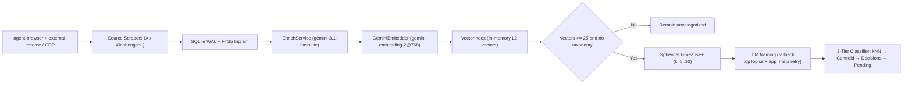
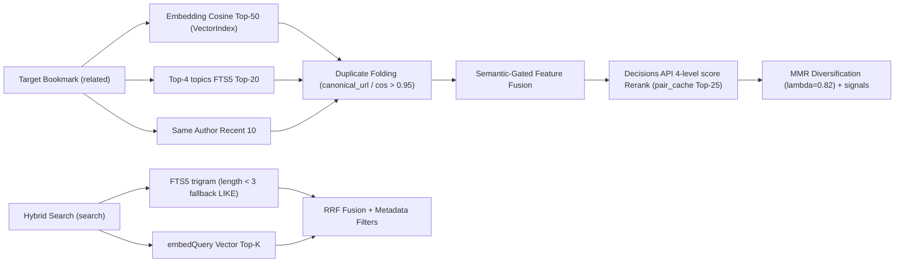
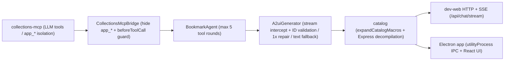

English | [简体中文](README.zh.md)

# Bookmark Agent

A **local-first**, multi-platform personal bookmark knowledge base and AI Agent desktop application. Sync your **X (Twitter)** and **Xiaohongshu (RedNote)** bookmarks via an anti-detection manual browser session, run local SQLite multimodal enrichment, vector indexing, dynamic clustering with three-tier classification, multi-way retrieval with LLM reranking, and interact conversationally through guarded MCP tools and the **A2UI** declarative UI DSL.

---

## Architecture Overview

### 1. Cold Start & Dynamic Taxonomy



### 2. Related Search & Hybrid Retrieval



### 3. MCP Agent & A2UI Rendering



---

## Workspace Packages

| Package | Description |
| --- | --- |
| `packages/collections-mcp` | Core storage and retrieval engine: SQLite (`collections.db`), FTS5 trigram, in-memory `VectorIndex`, `AuthManager`, `ItemPipeline`, related search, dynamic clustering and three-tier classification, and the stdio MCP Server. |
| `packages/catalog` | A2UI component Catalog Schema (primitives `Text` / `Section` / `BadgeList` and macro components `CollectionCard` / `ItemGrid` / `ThemeCompare` / `Timeline`), server-side macro expansion (`expandCatalogMacros`), Express decompilation (`decompileSurfaceToExpress`), and single-line history summaries (`summarizeSurfaceForHistory`). |
| `packages/agent-core` | Transport-agnostic `BookmarkAgent` (up to 5 tool rounds), `CollectionsMcpBridge` (strips `app_*` internal management tools + intercepts writes via `beforeToolCall` confirmation), `A2uiGenerator` (stream interception, validation, 1x repair retry, plain-text fallback), and `AppSessionStore` (`app.db` sessions with FTS5 history search). |
| `packages/dev-web` | Local HTTP + SSE test harness (default port `4310`, `POST /api/chat/stream` streaming conversation and A2UI events) for rapid agent, retrieval, and UI iteration. |
| `packages/app` | Electron + React desktop client: hosts `AgentRuntime` inside an Electron `utilityProcess` reusing `BookmarkAgent`, encrypts API keys via `safeStorage`, and renders a virtualized multi-source bookmark grid and related-items drawer. |
| `packages/eval` | Fully sanitized synthetic evaluation dataset (`packages/eval/dataset/` with 60 cross-platform items, `classify.jsonl`, `related.jsonl`) and offline/live benchmark runner `packages/eval/run-eval.mjs`. |

---

## Core Data Pipelines

### 1. Cold Start & Taxonomy Construction

The cold-start pipeline from empty database to a structured taxonomy lives across `ItemPipeline`, `EnrichService`, `GeminiEmbedder`, and the classification subsystem:

1. **Scraping & Protected Ingestion (`agent-browser` + `checkSourceHealth`)**
   - **X (Twitter)** uses `external-chrome`: `spikes/x-bookmarks/chrome-profile.sh` (or desktop `app_login_handoff`) launches a dedicated Chrome window without automation flags for manual login, then attaches via `--cdp 9333`; **Xiaohongshu** supports `--cdp 9333` / `--user-id` (or `XHS_USER_ID`).
   - Only rendered DOM content is read — cookies, browser storage, and request headers are never accessed, persisted, or logged. Incremental sync stops as soon as the previous `cursor` is encountered, and `checkSourceHealth` verifies field population rates before committing.
   - Deleted items are masked via `deleted_at` tombstones and user edits are locked via `user_overrides`, preventing future syncs from overwriting user changes.
2. **Multimodal Enrichment (`EnrichService`)**
   - Processes batches of 8 items with `gemini-3.1-flash-lite` (automatically overflowing on daily quota exhaustion to `gemma-4-31b-it`, `gemma-4-26b-a4b-it`, and `gemini-3.5-flash-lite`), extracting `summary`, `topics`, `kind`, `lang`, and `imageCaptions` from up to 2 attached images, cached on disk via `DiskAiCache`.
3. **Representation & Vectorization (`GeminiEmbedder`)**
   - `buildRepresentationText` combines `title + summary + topics + imageCaptions + note + truncated text` (**intentionally excluding author handles and timestamps** so same-author bias does not dominate semantic similarity).
   - Batches of 40 items are embedded with `gemini-embedding-2` (768 dimensions), L2-normalized, persisted to SQLite `embeddings`, and upserted into the in-memory `VectorIndex` (incrementally skipping unchanged items via `text_hash`).
4. **Dynamic Clustering, Naming & Persistent Retry**
   - When the store has **< 25** vectors, no taxonomy is created and all items remain **Uncategorized** (`category = null`).
   - Once **>= 25** vectors exist and the taxonomy is empty, `ItemPipeline` triggers initial clustering automatically before `classify` (also invocable manually via `app_taxonomy_propose`):
     - Runs spherical `k-means++` over `k ∈ [5, 10]` (minimum 5 items per cluster) and selects the `k` maximizing silhouette score.
     - Selects the **10 closest representative bookmarks** per cluster plus the **top-12 frequent `topics`**, generating `{ cluster, id, name, description }` in a single LLM request, while saving the **8 closest items** as initial seed `examples`.
     - If no API key is configured or LLM naming fails: falls back to joining the cluster's **top 3 `topTopics`** as a temporary category name (`categories.name_source = 'topics'`) and persists `{ attempts, retryAfter, lastError }` in `app_meta['taxonomy_naming']` (`attempts: 0` when no key is set, `resetAt` on quota exhaustion, exponential backoff up to 5 attempts otherwise). `retryTaxonomyNaming` retries automatically on subsequent startups or syncs while strictly skipping categories renamed by the user (`name_source = 'user'`). Rebuilding preserves user-confirmed assignments (`source = 'user'`) via strict-majority remapping in `replaceTaxonomy`.
5. **Three-Tier Classification + Active Learning Queue (`classifyItems`)**
   - **Tier 1 — kNN**: Searches the top-15 labeled neighbors; assigns directly (`source = 'knn'`) when `>= 6` neighbors belong to the active taxonomy and distance-weighted voting (`exp(score / 0.05)`) reaches `>= 0.58`.
   - **Tier 2 — Weighted Centroid**: Computes L2-normalized category centroids (`3 * mean(user) + 1 * mean(seed)`), applies temperature-`0.035` softmax, and assigns directly (`source = 'centroid'`) when `top1 >= 0.34` and `top1 - top2 >= 0.08`.
   - **Tier 3 — Decisions API Fallback**: Batches 15 uncertain items per `gemini-decision-1` `choice` call, assigning (`source = 'decision'`) at confidence `>= 0.52`.
   - **Active Learning Queue (`pending`)**: Remaining ambiguous items enter `pending` for one-click user confirmation (`app_confirm`), immediately recomputing centroids and re-classifying affected items.

---

### 2. Related Search & Hybrid Retrieval

#### Related Bookmarks (`related` / `app_related`)

Finds related items across the collection using a four-stage **"Multi-Way Recall -> Semantic-Gated Coarse Ranking -> Decisions Rerank -> MMR"** pipeline:

1. **Three-Way Recall**:
   - Vector cosine top-50 (`VectorIndex`)
   - FTS5 top-20 queried from the target item's top-4 `topics`
   - 10 most recent items by the same author
2. **Duplicate Folding**: Non-X items sharing a `canonical_url` or candidates with cosine `cos > 0.95` are folded into `duplicates` rather than crowding top slots.
3. **Semantic-Gated Feature Fusion**:
   - Base score: `0.76 * cos + 0.06 * bm25Norm + 0.08 * topicJaccard`
   - Gated bonuses: same-author (`0.04`), same-category (`0.04`), and recency decay (`0.02`) are added **only when `cos >= 0.68` or `topicJaccard > 0`**, preventing off-topic posts from the same author from ranking high.
4. **Decisions API Rerank & `pair_cache`**:
   - Top-25 candidates are scored concurrently on a 4-level relevance scale (`0..3`) via `gemini-decision-1` and cached in SQLite `pair_cache`.
   - Final score blends `0.45 * featureScore + 0.55 * (decisionScore / 3)`, filtering out noise below `0.85 / 3`.
5. **MMR Diversification & Explainable Signals**:
   - Applies Maximal Marginal Relevance (`lambda = 0.82`) to down-rank near-duplicates (`cos > 0.80` against already selected results) and attaches human-readable `signals` tags.

#### Hybrid Search (`search`)

- Fuses SQLite FTS5 trigram results (automatically falling back to `LIKE` for queries under 3 characters) with `embedQuery` vector top-K via **Reciprocal Rank Fusion (RRF)**, supporting `source`, `author`, `category`, `topic`, and date-range filters.

---

### 3. MCP Tool Isolation & A2UI DSL

1. **Dual-Face MCP Isolation & Write Guards**
   - `packages/collections-mcp` exposes two stdio tool namespaces:
     - **LLM tools**: `search`, `get_items`, `read_item`, `related`, `list_categories`, `stats`, `add`, `update`, `remove`.
     - **App management tools (`app_*` prefix)**: `app_list_items`, `app_related`, `app_taxonomy_propose`, `app_categories_edit`, `app_pending`, `app_confirm`, `app_import_fixtures`, `app_sources`, `app_login_check`, `app_login_handoff`, `app_login_forget`, `app_pipeline_status`, `app_process_items`, `app_sync`.
   - `CollectionsMcpBridge` hides all `app_*` tools from the model and intercepts `add`, `update`, and `remove` via `beforeToolCall` so writes require explicit user confirmation.
2. **A2UI Rendering & Multi-Transport Runtime**
   - After up to 5 tool rounds, `BookmarkAgent` may emit an ```` ```a2ui ... ``` ```` JSON block. `A2uiGenerator` intercepts the fence during streaming, validates component schemas and item ID references against `packages/catalog` (pushing `surface_ready` on success, triggering 1 `finishTurn` repair retry on error, or gracefully degrading to plain text).
   - `expandCatalogMacros` expands high-level macro components (`CollectionCard` / `ItemGrid` / `ThemeCompare` / `Timeline`) into standard A2UI primitives on the server; across turns, active surfaces are decompiled via `decompileSurfaceToExpress` while older turns are compacted via `summarizeSurfaceForHistory`.
   - A single `BookmarkAgent` powers both transports:
     - **`packages/dev-web`**: HTTP + **SSE** (`POST /api/chat/stream` emitting `turn_start`, `tool_call_start`, `text_delta`, `surface_ready`, `turn_complete`, etc.).
     - **`packages/app`**: Electron **`utilityProcess` + MessagePort IPC** driving the React desktop client.

---

## Requirements & Configuration

- **Node.js >= 22** & **pnpm**
- **Google Gemini API Key**: Used for `enrich`, `embedding`, `decisions` classification/reranking, and agent chat (stored securely via system keychain / Electron `safeStorage` in **Settings**, or passed via `GEMINI_API_KEY`).
- Optional environment variables:
  - `COLLECTIONS_DB_PATH`: Override main SQLite database path (defaults to the OS app data directory `collections.db` in desktop mode, or `.worktrees-data/dev-collections.db` in `dev-web`).
  - `COLLECTIONS_SEED_PATH`: Comma-separated JSON/JSONL seed files imported on first boot when the database is empty (e.g., `packages/eval/dataset/items.json`).
  - `COLLECTIONS_MCP_CONFIG`: Path to a custom JSON config overriding model names, rate limits, or `free`/`paid` tier presets.
  - `XHS_USER_ID`: Xiaohongshu profile ID used by `spikes/xhs-bookmarks/scrape.mjs` or default login guidance.

---

## Quick Start

### 1. Install, Build & Run Tests

```bash
pnpm install
pnpm build
pnpm typecheck
pnpm test
```

### 2. Run Offline / Live Evaluations (Synthetic Dataset)

The sanitized evaluation dataset lives at [packages/eval/dataset/items.json](packages/eval/dataset/items.json) (60 synthetic cross-platform bookmarks with precomputed embeddings and cached decisions), reproducing related-search ablations and clustering/classification metrics without any personal data:

```bash
# Offline benchmark (uses dataset/decisions-cache.json)
pnpm eval

# Optionally generate REPORT.md (gitignored) or hit live Decisions API
node packages/eval/run-eval.mjs --write-report
GEMINI_API_KEY=your_key node packages/eval/run-eval.mjs --live --write-report
```

### 3. Start Web Harness (`dev-web` + SSE)

```bash
# Optional: seed empty DB with synthetic dataset on first boot
COLLECTIONS_SEED_PATH=packages/eval/dataset/items.json pnpm --filter @bookmark-agent/dev-web start
```

Open `http://127.0.0.1:4310`.

### 4. Start Electron Desktop App

```bash
pnpm build
pnpm --filter @bookmark-agent/app start
```

> If Electron reports a `better-sqlite3` ABI mismatch, run `pnpm --filter @bookmark-agent/app rebuild:electron`.

### 5. Manual Login & Standalone Scrapers (`spikes/`)

To capture live bookmarks from the command line:

```bash
# 1) Launch clean Chrome debug profile (stored under $HOME/.config/browser-login/profiles)
bash spikes/x-bookmarks/chrome-profile.sh start

# 2) Log into X / Xiaohongshu manually in the opened window, then scrape X via CDP
node spikes/x-bookmarks/scrape.mjs --cdp 9333 --max-scrolls 5

# 3) Scrape Xiaohongshu bookmarks via CDP
XHS_USER_ID=<your_user_id> node spikes/xhs-bookmarks/scrape.mjs --cdp 9333
```

> **Security boundary**: Both scrapers and MCP `sources` modules read **only the rendered DOM** — browser cookie stores, auth tokens, and request headers are never accessed or logged.
