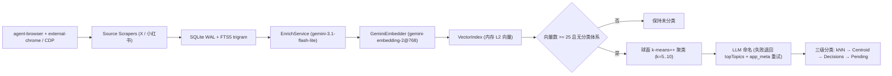
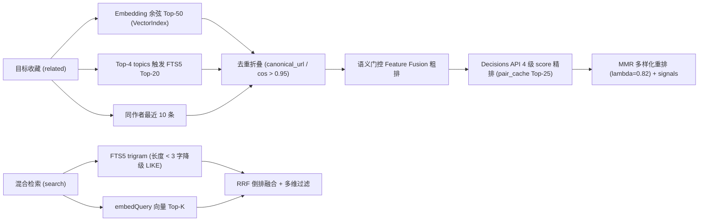
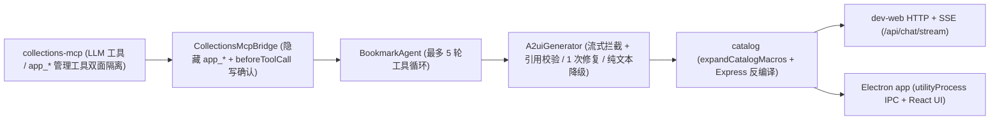

[English](README.md) | 简体中文

# Bookmark Agent

一个本地优先（Local-First）的多平台个人收藏知识库与 AI Agent 桌面应用：支持通过无自动化特征浏览器同步 **X (Twitter)** 与 **小红书** 收藏，在本地 SQLite 中完成多模态增强、向量索引、动态聚类与三级分类、三路召回与精排相关搜索，并通过受控 MCP 工具与 **A2UI** 声明式界面 DSL 提供对话式检索与整理体验。

---

## 整体架构

### 1. 冷启动与分类体系构建



### 2. 相关搜索与混合检索



### 3. MCP Agent 与 A2UI 渲染



---

## Workspace 模块说明

| 包路径 | 说明 |
| --- | --- |
| `packages/collections-mcp` | 核心数据与检索引擎：SQLite (`collections.db`)、FTS5 trigram、内存 `VectorIndex`、`AuthManager`、`ItemPipeline`、相关搜索、动态聚类与三级分类，以及 stdio MCP Server。 |
| `packages/catalog` | A2UI 组件 Catalog Schema（基础组件 `Text` / `Section` / `BadgeList` 与宏组件 `CollectionCard` / `ItemGrid` / `ThemeCompare` / `Timeline`）、服务端宏展开（`expandCatalogMacros`）、Express 反编译（`decompileSurfaceToExpress`）与历史单行摘要（`summarizeSurfaceForHistory`）。 |
| `packages/agent-core` | 传输无关的 `BookmarkAgent`（最多 5 轮工具循环）、`CollectionsMcpBridge`（屏蔽 `app_*` 内部管理工具 + `beforeToolCall` 拦截写操作确认）、`A2uiGenerator`（流式拦截、校验、1 次修复重试、纯文本降级）与 `AppSessionStore`（`app.db` 会话与 FTS5 历史搜索）。 |
| `packages/dev-web` | 本地 HTTP + SSE 验证端（默认端口 `4310`，`POST /api/chat/stream` 推送对话与 A2UI 事件流），便于快速联调对话、检索与 UI 渲染。 |
| `packages/app` | Electron + React 桌面端：主进程通过 `utilityProcess` 托管 `AgentRuntime` 复用 `BookmarkAgent`，`safeStorage` 加密持久化 API Key，提供虚拟滚动多源卡片网格与相关收藏分组视图。 |
| `packages/eval` | 完全脱敏的合成评测集（`packages/eval/dataset/` 共 60 条跨平台收藏、`classify.jsonl`、`related.jsonl`）与离线/在线评测脚本 `packages/eval/run-eval.mjs`。 |

---

## 核心数据处理流程

### 1. 冷启动与分类体系构建

从空白库冷启动到可用分类体系的完整链路集中在 `ItemPipeline`、`EnrichService`、`GeminiEmbedder` 与分类模块中：

1. **抓取与防覆盖入库（`agent-browser` + `checkSourceHealth`）**
   - **X (Twitter)** 走 `external-chrome` 模式：通过 `spikes/x-bookmarks/chrome-profile.sh`（或桌面端 `app_login_handoff`）打开无自动化特征的独立 Chrome 窗口由用户手动登录，随后通过 `--cdp 9333` 附着抓取；**小红书**支持 `--cdp 9333` / `--user-id`（或环境变量 `XHS_USER_ID`）。
   - 仅读取已渲染 DOM，不读取、不持久化、也不在日志中打印 Cookie / Storage / 请求头；增量同步在命中上一次 `cursor` 时立即截断；入库前经过 `checkSourceHealth` 字段填充率校验。
   - 已被用户删除的收藏通过 `deleted_at` 软删除墓碑屏蔽，已被用户手动修改的字段通过 `user_overrides` 锁定，重同步不会覆盖用户变更。
2. **多模态内容增强（`EnrichService`）**
   - 每批 8 条调用主模型 `gemini-3.1-flash-lite`（遇到日配额耗尽时自动按序溢出到 `gemma-4-31b-it`、`gemma-4-26b-a4b-it`、`gemini-3.5-flash-lite`），结合正文与最多 2 张配图抽取 `summary`、`topics`、`kind`、`lang` 与 `imageCaptions`，结果通过 `DiskAiCache` 缓存到本地。
3. **表示构建与向量化（`GeminiEmbedder`）**
   - `buildRepresentationText` 按 `标题 + 摘要 + 主题 + 配图描述 + 用户备注 + 截断正文` 构造语义表示（**刻意排除作者与时间戳**，避免同作者效应主导语义相似度）。
   - 每批 40 条调用 `gemini-embedding-2`（768 维）生成 L2 归一化向量写入 SQLite `embeddings` 表与内存 `VectorIndex`；通过文本 `text_hash` 增量跳过未改动条目。
4. **动态聚类、命名与故障重试**
   - 向量数 **< 25** 时不建立分类体系，条目统一显示为 **未分类**（`category = null`）。
   - 当分类表为空且向量数 **>= 25** 时，`ItemPipeline` 在 `classify` 阶段前自动触发首次聚类（也可通过 `app_taxonomy_propose` 显式重建）：
     - 在 `k ∈ [5, 10]`（每簇至少 5 条）运行球面 `k-means++`，依据轮廓系数（Silhouette）选择最佳 `k`。
     - 对每个簇挑选离质心最近的 **10 条代表收藏** 与 **Top-12 高频 `topics`**，单次 LLM 请求生成 `{ cluster, id, name, description }`，并记录离质心最近的 **8 条**作为初始种子样本（`examples`）。
     - 若缺少 API Key 或 LLM 命名失败：退回使用簇内出现最多的 **前 3 个 `topTopics`** 拼接作为临时类名（`categories.name_source = 'topics'`），并在 `app_meta['taxonomy_naming']` 中持久化 `{ attempts, retryAfter, lastError }`（无 Key 记 `attempts: 0`，配额耗尽读取 `resetAt`，其他错误按指数退避，最多 5 次）。后续启动或同步后 `retryTaxonomyNaming` 自动重试命名，同时严格跳过已被用户手动改名（`name_source = 'user'`）的类别；重建体系时通过 `replaceTaxonomy` 按严格多数票迁移用户已确认的归类（`source = 'user'`）。
5. **三级自动分类 + 主动学习队列（`classifyItems`）**
   - **第一级 kNN**：从已分类样本中检索 Top-15 邻居；当命中同体系邻居数 `>= 6` 且经 `exp(score / 0.05)` 距离加权投票最高概率 `>= 0.58` 时直接归类（`source = 'knn'`）。
   - **第二级加权质心（Centroid）**：为每个类别计算 `3 * mean(user) + 1 * mean(seed)` 的加权 L2 归一化质心，经温度 `0.035` softmax 归一化；当 `top1 >= 0.34` 且 `top1 - top2 >= 0.08` 时直接归类（`source = 'centroid'`）。
   - **第三级 Decisions API 兜底**：以 `gemini-decision-1` 的 `choice` 模式每批 15 条并发判定，置信度 `>= 0.52` 时归类（`source = 'decision'`）。
   - **主动学习队列（`pending`）**：仍不确定的条目进入 `pending` 队列，由用户在桌面端一键确认（`app_confirm`）；确认后即时重算质心并对受影响条目重跑分类。

---

### 2. 相关搜索与混合检索

#### 相关搜索（`related` / `app_related`）

面向“找与某条收藏相关的其它收藏”，采用“**多路召回 -> 语义门控粗排 -> Decisions 精排 -> MMR 去冗**”四段式流水线：

1. **三路召回**：
   - 向量余弦相似度 Top-50（`VectorIndex`）
   - 基于目标条目 Top-4 `topics` 的 FTS5 全文召回 Top-20
   - 同作者最近 10 条收藏
2. **去重折叠**：非 X 来源共享同一 `canonical_url` 或余弦相似度 `cos > 0.95` 的候选折叠进 `duplicates`，不重复占满推荐位。
3. **带语义门控的 Feature Fusion 粗排**：
   - 基础融合分：`0.76 * cos + 0.06 * bm25Norm + 0.08 * topicJaccard`
   - 语义门控辅助信号：仅当 `cos >= 0.68` 或 `topicJaccard > 0` 时，才叠加同作者（`0.04`）、同分类（`0.04`）与时间衰减（`0.02`），防止纯同作者把无关内容推到前列。
4. **Decisions API 精排与 `pair_cache`**：
   - 取粗排 Top-25 调用 `gemini-decision-1` 的 4 级相关性打分 `score`（`0..3` 分）并发精排，并持久化到 SQLite `pair_cache` 避免重复调用。
   - 以 `0.45 * featureScore + 0.55 * (decisionScore / 3)` 融合最终得分，并过滤相关性低于 `0.85 / 3` 的噪点。
5. **MMR 多样化重排与可解释标签**：
   - 应用 Maximal Marginal Relevance（`lambda = 0.82`），对与已选结果互相余弦 `> 0.80` 的近重复候选降权，并为每条推荐附加可读 `signals` 标签。

#### 混合全文检索（`search`）

- 将 SQLite FTS5 trigram 召回（对于 `< 3` 字符的短查询自动降级为 `LIKE`）与 `embedQuery` 向量检索 Top-K 通过 **RRF（Reciprocal Rank Fusion）** 融合，并支持按 `source`、`author`、`category`、`topic` 与时间范围过滤。

---

### 3. Agent 工具隔离与 A2UI 界面 DSL

1. **MCP 工具双面隔离与写操作护栏**
   - `packages/collections-mcp` 同时向两类调用方提供 stdio 工具：
     - **LLM 只读/受控工具**：`search`、`get_items`、`read_item`、`related`、`list_categories`、`stats`、`add`、`update`、`remove`。
     - **App 内部管理工具（`app_*` 前缀）**：`app_list_items`、`app_related`、`app_taxonomy_propose`、`app_categories_edit`、`app_pending`、`app_confirm`、`app_import_fixtures`、`app_sources`、`app_login_check`、`app_login_handoff`、`app_login_forget`、`app_pipeline_status`、`app_process_items`、`app_sync`。
   - `CollectionsMcpBridge` 自动对模型隐藏所有 `app_*` 工具，并通过 `beforeToolCall` 拦截 `add` / `update` / `remove` 写操作，要求用户显式确认后才允许落库。
2. **A2UI 声明式渲染与双向传输**
   - Agent 最多执行 5 轮工具调用后，可在回复中输出 ```` ```a2ui ... ``` ```` JSON 代码块；`A2uiGenerator` 在流式输出阶段拦截该块，基于 `packages/catalog` 执行组件编译与收藏 ID 引用校验（校验通过只推送 `surface_ready`，失败自动触发 1 次 `finishTurn` 修复重试，仍失败则降级为纯文本保证可用）。
   - `expandCatalogMacros` 在服务端将高层宏组件（`CollectionCard` / `ItemGrid` / `ThemeCompare` / `Timeline`）展开为标准 A2UI 原语；跨轮次时，当前活跃 Surface 通过 `decompileSurfaceToExpress` 反编译供模型理解与局部调整，历史 Surface 通过 `summarizeSurfaceForHistory` 压缩为单行摘要节省上下文。
   - 同一套 `BookmarkAgent` 同时服务于：
     - **`packages/dev-web`**：通过 HTTP + **SSE**（`POST /api/chat/stream`，推送 `turn_start` / `tool_call_start` / `text_delta` / `surface_ready` / `turn_complete` 等事件）驱动 Web UI。
     - **`packages/app`**：通过 Electron **`utilityProcess` + MessagePort IPC** 驱动 React 桌面客户端。

---

## 环境要求与配置

- **Node.js >= 22** & **pnpm**
- **Google Gemini API Key**：用于 `enrich`、`embedding`、`decisions` 分类/精排以及 Agent 对话（可在桌面端 **Settings** 中安全写入系统密钥链 / Electron `safeStorage`，或通过环境变量 `GEMINI_API_KEY` 传入）。
- 可选环境变量：
  - `COLLECTIONS_DB_PATH`：覆盖 SQLite 主库路径（默认桌面端使用系统应用数据目录下的 `collections.db`，`dev-web` 默认使用 `.worktrees-data/dev-collections.db`）。
  - `COLLECTIONS_SEED_PATH`：首次启动库为空时导入的 JSON/JSONL 种子文件列表（逗号分隔），例如内置脱敏示例数据 `packages/eval/dataset/items.json`。
  - `COLLECTIONS_MCP_CONFIG`：自定义 JSON 配置文件路径，覆盖模型名、并发限流、免费/付费预设挡位等参数。
  - `XHS_USER_ID`：小红书用户主页 ID（配合 `spikes/xhs-bookmarks/scrape.mjs` 或默认登录引导使用）。

---

## 快速开始

### 1. 安装依赖、构建与运行全部测试

```bash
pnpm install
pnpm build
pnpm typecheck
pnpm test
```

### 2. 运行离线/在线评测（使用脱敏合成数据集）

评测集位于 [packages/eval/dataset/items.json](packages/eval/dataset/items.json)（60 条多来源合成收藏与预先计算好的向量/判定缓存），无需真实个人数据即可复现三路相关搜索消融与动态聚类/分类指标：

```bash
# 离线评测（使用 dataset/decisions-cache.json）
pnpm eval

# 如需生成 REPORT.md（已被 .gitignore 忽略）或在线调 Decisions API
node packages/eval/run-eval.mjs --write-report
GEMINI_API_KEY=your_key node packages/eval/run-eval.mjs --live --write-report
```

### 3. 启动 Web 验证端（`dev-web` + SSE）

```bash
# 可选：首次启动时导入脱敏合成数据集体验全部检索与聚类功能
COLLECTIONS_SEED_PATH=packages/eval/dataset/items.json pnpm --filter @bookmark-agent/dev-web start
```

启动后访问 `http://127.0.0.1:4310`。

### 4. 启动 Electron 桌面客户端

```bash
pnpm build
pnpm --filter @bookmark-agent/app start
```

> 若桌面端提示 `better-sqlite3` ABI 与 Electron 版本不匹配，可先运行 `pnpm --filter @bookmark-agent/app rebuild:electron`。

### 5. 手动登录与抓取脚本（`spikes/`）

用于独立验证或命令行同步真实收藏时，可按需运行：

```bash
# 1) 启动无自动化特征的独立 Chrome 调试窗口（Profile 保存在 $HOME/.config/browser-login/profiles）
bash spikes/x-bookmarks/chrome-profile.sh start

# 2) 在弹出的浏览器窗口中手动登录 X / 小红书后，通过 CDP 增量抓取 X 书签
node spikes/x-bookmarks/scrape.mjs --cdp 9333 --max-scrolls 5

# 3) 抓取小红书收藏（支持 --cdp 附着或传入 --user-id）
XHS_USER_ID=<your_user_id> node spikes/xhs-bookmarks/scrape.mjs --cdp 9333
```

> **安全边界**：所有抓取脚本与 MCP `sources` 模块均严格遵循**只读已渲染 DOM** 原则，绝不读取浏览器 Cookie 数据库，也不记录或透传身份凭证到日志或模型上下文中。
