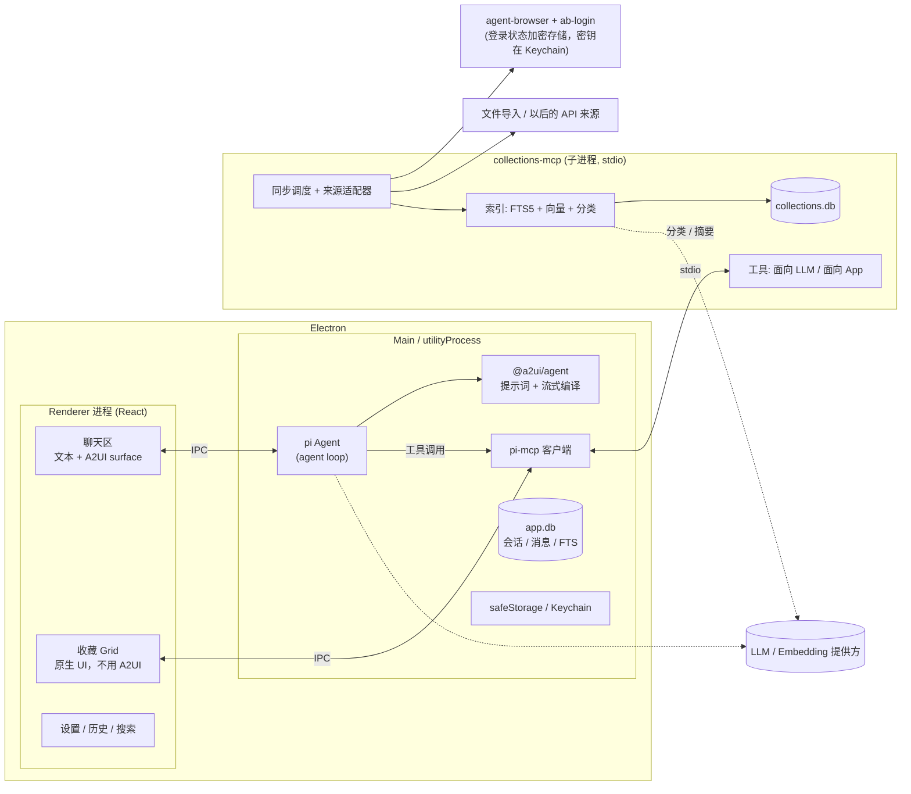

# 收藏管理 Agent：需求分析与方案

> 2026-11-19。延续 [a2ui/06-build-your-own-agent.md](../a2ui/06-build-your-own-agent.md) 的思路：pi-agent-core 负责 agent loop，A2UI 负责聊天里的生成式 UI，收藏服务做成独立的 MCP。
> 已核对的事实：`~/.claude/skills/browser-login`（ab-login），pi 的 `packages/mcp` 客户端能力，Jev 文档（docs.typesafe.ai）。

---

## 0. 结论先行

| 议题 | 你的想法 | 建议 |
|---|---|---|
| 收藏服务做成独立 MCP | ✅ | 同意。但它要同时面向**两类调用方**：给 LLM 的少量工具，以及给 App UI 的数据接口。App 直接调用 MCP 工具，不经过 LLM |
| 爬虫与登录用 agent-browser | ✅ | 同意，ab-login 正好合适。**首批只做 X，不做 Notion**。抓取逻辑做成"通用框架 + 每个平台一份声明式配置"（§3.2），不要让 LLM 每次去浏览网页 |
| CSV 还是 SQLite | 都可以 | **SQLite**。理由：FTS5 全文检索、向量扩展、增量同步状态、两个进程同时读写。数据量小不是选 CSV 的理由 |
| 相关度用 decision API 预处理 | 调整为两段式 | **embedding 召回 + Google Decisions API 精判**。入库时预先算好 embedding；右键时实时召回约 30 个候选，再用 **1 次** Decisions 请求（共享 input + 每个候选一个 `score` 问题）精判。成本是每次右键 O(k)，避免了 N²。详见 [embedding-related-classify.md](embedding-related-classify.md) |
| 分类预处理 | ✅ | 入库时完成：**kNN 投票 → embedding 质心 → Decisions `choice` 兜底 → 待确认**，用户的修正永远优先；分类体系由聚类提议、用户确认。详见同一文档 §4 |
| Jev / Google Decisions API | — | **Google Decisions API**（`gemini-decision-1`）：一份共享输入 + 1–1000 个问题，校准概率，只按输入计费。**TypeSafe 的 Jev** 的原语与之类似。两者都没有 embedding 或相似度能力，适合精判和分类，不适合全库召回。默认用 Google 的，与 Gemini embedding 共用一个 key |
| 工具：list_all / search(可选) / add / remove | 调整 | **search 是必需的，list_all 不该给 LLM**（几千条数据塞不进上下文）。另外缺一个关键工具 **`read_item`**：LLM 要回答问题，需要收藏的**正文**，而不只是 URL 和标题 |
| MCP 侧 LLM 配置放在哪 | — | **App 的设置界面是唯一入口**，配置写进 MCP 自己的配置文件，密钥放 Keychain，启动 MCP 时通过 env 注入。MCP 也要能**脱离 App 独立运行**（例如接入 Claude Code）。详见 §7 |

---

## 1. 整体架构



**关键划分：**

- **右侧 Grid 是固定的核心界面，用原生 React 写，不用 A2UI。** 它的数据直接来自 MCP（`list_items` 等），不经过 LLM，所以快、确定、不花 token。
- **A2UI 只用在聊天区**，由 LLM 生成回答里的富 UI：相关收藏卡片、主题对比、时间线等。
- **两者联动**（这是 A2UI 价值最明显的地方，见 §6）：
  - Grid 中选中的条目可以作为上下文附到聊天里。
  - 聊天里的卡片可以点击，联动高亮 Grid 中的条目。

---

## 2. collections-mcp 的职责与边界

### 2.1 做成独立 MCP 的利弊

| 优点 | 代价 |
|---|---|
| 可复用：Claude Code、Claude Desktop 或其他 agent 都能直接用你的收藏库 | App 需要的接口（分页、排序、同步进度、登录交接）远多于 LLM 需要的工具 |
| 隔离：浏览器、登录状态、爬虫的崩溃都关在子进程里 | 长任务（同步、首次 embedding）和交互（登录）不是简单的请求/响应模型 |
| 边界清晰：数据层与对话层解耦，各自可替换 | 多一层进程间通信 |

**结论：值得做，但要设计成"两张面孔"。**

- **LLM 面孔**：少量、语义清晰的工具。
- **App 面孔**：完整的数据和管理接口。

由 App（MCP host）决定把哪些工具暴露给 LLM，这完全在 host 侧控制，MCP 协议不需要区分。命名上可以加前缀区分，比如 `app_*` 的工具不注入给 LLM。

### 2.2 长任务与交互：用 MCP 协议自带的机制

已核对 `@earendil-works/pi-mcp` 的客户端：
- **支持** `onProgress`（`notifications/progress`）、取消请求、通用的通知监听。
- **支持**通用的 `setRequestHandler`。
- `ClientCapabilities` 里有 `sampling` 和 `elicitation` 字段，但**没有现成的处理逻辑**，需要你自己声明能力并实现对应的处理函数。

| 场景 | 机制 |
|---|---|
| 同步进度（"已抓取 120/300"） | `sync_source` 调用时带 progressToken，服务端发 `notifications/progress`；App 在 Grid 顶部显示进度条 |
| 新条目入库 → Grid 刷新 | 服务端发自定义通知（例如 `notifications/collections/changed {ids}`），或者用 resources + `notifications/resources/updated` |
| 需要用户登录 | 服务端检测到 `ab-login check` 返回 2，就返回结构化错误 `NEEDS_LOGIN {sourceId}`，**由 App 弹出"去登录"按钮**。用户点击后，App 调用 `app_login_handoff`。也可以用 MCP elicitation 让服务端主动发起，但需要自己实现 |
| 首次全量 embedding 或重新分类 | 作为后台任务执行，用进度通知汇报，不要让 LLM 的工具调用阻塞在上面 |

---

## 3. 数据采集：登录、适配器、增量同步

### 3.1 登录：照搬 ab-login 的模型

ab-login 的设计（人工在有界面的浏览器窗口登录一次；状态用 Keychain 中的密钥加密保存；按 identity 探测是否仍有效；过期后交还给人）**正好满足本地应用的需求**。可以直接映射：

| ab-login | 收藏 App |
|---|---|
| `identities.json`（`checkUrl` / `checkText` / `doneFn`） | 每个来源适配器**内置**一份 identity 模板（例如 `x-prod-<handle>`），用户不需要手写 |
| `check` | 每次同步前做一次无界面探测；设置页的"来源"列表显示 VALID / EXPIRED |
| `handoff` | 设置页的「连接 X 账号」按钮。弹出有界面的窗口，用户自己登录（验证码、2FA 都可以），超时则提示 |
| `open <id> <session>`（never-save） | 同步任务用只读会话，避免抓取过程中误登出而污染已保存的登录状态 |
| 规则：凭证永不进入对话 | 在 App 里更容易做到：**登录根本不是 LLM 的动作**，而是 UI 动作。LLM 只能看到"来源 X：需要登录"这样的状态 |

需要注意的点：
- ab-login 是 bash 脚本，依赖 `jq`、`node`、`security`、`osascript`，**只能在 macOS 上用**。如果要跨平台，或者要把它打包进 Electron，建议在 MCP 里用 TS **重写这一百多行逻辑**，直接调用 agent-browser 的 `--restore` / `--restore-save` / `--restore-check-*` 参数，密钥用 Electron `safeStorage` 或 `keytar`。
- 需要打包或检测 agent-browser（版本 ≥ 0.41）及其 Chromium。首次运行时做环境检测。
- 每个账号一个 identity（`<site>-<env>-<account>`），以支持多账号。
- 同一个 identity 恢复出的多个会话共享同一个服务端 session，**同步任务要串行**，以免互相干扰或触发风控。

#### 登录方式的修订（2026-11-19，S1 的实际结果）

在 agent-browser 启动的自动化窗口里登录 X 时，`begin_login` 返回 "We've temporarily limited your login"。检查到的自动化特征：`navigator.webdriver=true`，并且我给浏览器加的 User-Agent 覆盖使 `userAgentData.brands` 为空（UA 与客户端提示不一致，登录用的有头窗口其实不需要这个覆盖）。因此**登录这一步不再放在自动化浏览器里**，改为两种可替换的 `login.mode`：

| mode | 做法 | 状态 |
|---|---|---|
| `external-chrome`（X 首选） | 用平时的 Chrome（专用数据目录、无自动化参数、无调试端口）手动登录；采集时用同一目录重新启动并开放仅本机可访问的调试端口，agent-browser 通过 `--cdp --pin-tab` 附着。脚本：`spikes/x-bookmarks/chrome-profile.sh`。实测在该模式下 `webdriver=false`、品牌信息完整 | 机制已验证（example.com）；X 登录待验证 |
| `automated-handoff` | 原 ab-login：agent-browser 有头窗口交接 | 适合风控较松的站点；X 上被限制 |

以后接入其他平台时，登录方式由平台配置选择；手动文件导入始终作为兜底。调试端口只在采集期间开放，因为本机任何能连上它的进程都能操控这个浏览器，包括读取其 cookie。

### 3.2 适配器：确定性脚本优先，LLM 只作兜底

> 范围（2026-11-19 确定）：**首批只做 X**，Notion 不做。适配器框架按"登录型社交媒体"通用化设计，以后接入小红书、微博、知乎、B 站时只需新增一份声明式配置和少量提取代码。

需要登录的社交媒体收藏页，结构都大致相同：**登录 → 打开收藏页 → 虚拟滚动列表 → 逐条提取 → 遇到已同步的条目就停止**。所以把通用流程放进框架，平台差异放进一份声明式配置：

```ts
// 框架负责：ab-login 检查和交接、串行会话、滚动循环、去重、增量停止、限速、失效检测
interface SocialSource {
  id: "x" | "xiaohongshu" | "weibo" | ...;
  identity: { checkUrl: string; checkText?: string; checkFn?: string; loginUrl?: string; doneFn?: string }; // 即 ab-login 的 identity 模板
  listUrl: string;                                    // 例如 "https://x.com/i/bookmarks"
  order: "newest-first" | "unordered";                // newest-first 才能"遇到已同步的条目就停止"
  itemSelector: string;                               // 列表项的根节点
  extract: string;                                    // 在页面内执行的 JS：把可视区域内的列表项转成 RawItem[]（id、url、text、author、time、media、quote、linkCard）
  scroll: { stepPx: number; pauseMs: [number, number]; maxIdleRounds: number };  // 随机停顿，模拟真人
  fetchDetail?: string;                               // read_item：打开详情页提取全文或线程
  health: { minFieldsFilled: Record<string, number> };// 例如 text 字段的填充率低于 0.8 就判定为"疑似改版"
}

async function* syncSocial(src: SocialSource, cursor?: string) {
  await ensureLoggedIn(src.identity);                 // check 失败 → 抛出 NEEDS_LOGIN，由 App 引导用户交接
  const s = await abOpen(src.id, `sync-${src.id}`, src.listUrl);   // never-save 会话
  const seen = new Set<string>(); let idle = 0;
  while (idle < src.scroll.maxIdleRounds) {
    const batch: RawItem[] = await s.eval(src.extract);
    const fresh = batch.filter(i => !seen.has(i.id)); fresh.forEach(i => seen.add(i.id));
    for (const it of fresh) {
      if (src.order === "newest-first" && it.id === cursor) return;  // 增量停止
      yield it;
    }
    idle = fresh.length ? 0 : idle + 1;
    await s.scrollBy(src.scroll.stepPx); await sleepRand(src.scroll.pauseMs);
  }
  checkHealth(src, seen);                             // 填充率异常 → 告警 + 可选"LLM 读快照修复 extract"
}
```

| 来源类型 | 做法 |
|---|---|
| **需要登录的社交媒体**（**X 首批**；以后是小红书、微博、知乎、B 站 …） | 用上面的 `SocialSource` 框架 |
| **文件导入**（W1 spike 抓取的 JSON 快照、浏览器书签 HTML、CSV） | 不是主要功能，但**开发时非常有用**：可以作为测试数据，不必每次都去爬真实账号；也是适配器失效时的兜底。（我没有确认 X 官方的数据导出是否包含书签，所以不依赖它） |
| 有 API 的来源 | 暂不做 |

**为什么不让 LLM 驱动浏览器抓取**：每次同步都会花 token；结果不确定；速度慢；页面一改就静默出错。建议的分工是：
- 确定性脚本负责 90% 的工作。
- 当选择器失效、提取结果为空或结构异常时，**降级为"LLM 读取快照、修复提取"**，并告警，让你更新适配器。

**X 适配器要点**（首批来源；选择器我没有实测，以实际 DOM 为准）：
- 入口是 `x.com/i/bookmarks`，**X 现在会把它重定向到 `x.com/i/history`**（新的 History 页，含 "Bookmarks" 和 "Likes" 两个标签）。判断是否在书签列表，不能只看网址，要看 `[role=tab][aria-selected=true]` 是 Bookmarks，并用每条帖子的 `removeBookmark` 标记确认它确实是书签（2026-11-20 实测）。列表按收藏时间倒序，第一条与书签页最上面一条一致，所以**遇到已同步过的推文 id 就停止**，实现增量（增量本身还没实测）。
- 列表是**虚拟滚动**：DOM 中只保留可视区域附近的推文，必须**边滚动边提取**，并按推文 id 去重。
- 推文 id 从 `/status/<id>` 链接中取，发布时间从 `<time datetime>` 取。**X 不显示收藏时间**，所以 `collected_at` 留空，用 `first_seen_at` 代替。
- 引用推文、链接卡片、图片要一起提取（enrich 需要它们）；长推文和线程在 `read_item` 时再打开详情页获取。
- 坚持用 DOM 提取，不要抓取网络响应：browser-login 的规则禁止导出 header 等敏感信息，抓取网络响应容易越过这条线。
- 慢速滚动，不要并发，同步间隔不少于数小时。

**风险提示**：抓取自己账号的收藏属于个人使用，但仍需注意：
- 平台的服务条款和风控：低频、增量、像真人一样操作，不并发。
- 页面改版导致适配器失效：要有监控（同步结果为 0 或字段为空率突增）。
- X 收藏页的 DOM 没有"标题"，只有正文、作者、媒体。

### 3.3 增量同步要点

- 每个来源保存一个 **cursor**：上次同步时最新条目的 `source_item_id` 或时间戳。抓取时遇到已存在的条目就停止。
- **定期全量对账**，例如每周一次，用于发现"用户在源站取消了收藏"。是否同步删除由用户设置决定，默认只标记。
- 同步触发方式：App 启动后、定时、手动。

---

## 4. 数据存储：SQLite

数据量确实小（几千到几万条），但这里选 SQLite 不是为了性能，而是为了**功能**：FTS5 全文检索、向量检索扩展（如 `sqlite-vec`）、事务、增量状态、两个进程同时读写（WAL 模式）。CSV 适合做**导出格式**。

### 4.1 字段：比你列的多几个关键字段

```sql
CREATE TABLE items (
  id            TEXT PRIMARY KEY,          -- 本地 uuid
  source        TEXT NOT NULL,             -- 'x' | 'import' | 以后的 'xiaohongshu' ...
  source_item_id TEXT NOT NULL,            -- ★ 去重与增量的依据
  account       TEXT,                      -- 多账号
  url           TEXT NOT NULL,
  canonical_url TEXT,                      -- ★ 跨来源去重（去掉 utm 参数、短链展开）
  title         TEXT,                      -- 可空（推文没有标题）
  excerpt       TEXT,                      -- ★ 正文摘要或推文全文：相关度和分类主要靠它
  author        TEXT,                      -- ★ 相关度的信号之一，也可用于筛选
  cover_url     TEXT, cover_path TEXT,     -- 封面缓存到本地（远程图会过期或防盗链）
  media_type    TEXT,                      -- article | post | image | video | repo ...
  publish_date  TEXT,                      -- 可空
  collected_at  TEXT,                      -- 可空（源站不一定提供）
  first_seen_at TEXT NOT NULL,             -- ★ 本地首次同步时间，collected_at 缺失时用它代替
  updated_at    TEXT NOT NULL,
  deleted_at    TEXT,                      -- ★ 软删除（墓碑）：防止重新同步把删掉的条目"复活"
  user_overrides TEXT,                     -- ★ JSON：用户手动改过的字段，同步时不覆盖
  raw           TEXT,                      -- 源站原始 JSON，便于以后重新解析
  UNIQUE (source, account, source_item_id)
);
CREATE TABLE item_content (item_id TEXT PRIMARY KEY, text TEXT, fetched_at TEXT, status TEXT); -- read_item 的缓存
CREATE TABLE embeddings   (item_id TEXT, model TEXT, dim INT, vec BLOB, text_hash TEXT, PRIMARY KEY(item_id, model));
CREATE TABLE categories   (id TEXT PRIMARY KEY, name TEXT, description TEXT, examples TEXT, sort INT);
CREATE TABLE item_category(item_id TEXT, category_id TEXT, score REAL, source TEXT, -- 'auto' | 'user'
                           PRIMARY KEY(item_id));
CREATE TABLE sources      (id TEXT PRIMARY KEY, adapter TEXT, account TEXT, identity TEXT,
                           cursor TEXT, last_sync_at TEXT, last_status TEXT, settings TEXT);
CREATE VIRTUAL TABLE items_fts USING fts5(title, excerpt, author, content='items', tokenize='trigram');
```

带 ★ 的字段解决的是**增量同步和用户编辑**中一定会遇到的问题：重复、复活、覆盖用户的修改、缺少标题。

**删除的语义**需要先定下来："删除"只在本地删除，还是同时在源站取消收藏？**建议 MVP 只做本地软删除**。回写源站需要写操作的选择器，风控风险也更高。

### 4.2 中文全文检索（收藏和聊天历史都会遇到）

FTS5 默认的 `unicode61` 分词器**不切分中文**，整句会被当成一个 token。可选方案：

- `tokenize='trigram'`：开箱即用，支持中文子串匹配。但**少于 3 个字的查询**（如"设计"）匹配不到，要降级为 `LIKE '%设计%'`。数据量小，这样做完全可以接受。
- 加载一个中文分词扩展（例如基于 jieba 的 FTS5 tokenizer）：效果更好，但要随 Electron 打包原生扩展，并处理跨平台编译。

**建议**：用 trigram，短查询降级为 LIKE，同时用向量检索做语义补充（见 §5）。

---

## 5. 相关度与分类

> **以 [embedding-related-classify.md](embedding-related-classify.md) 为准**：两段式相关度（embedding 召回 + Decisions API 精判）、三级分类器、由聚类提议分类体系、评测方法。本节的初稿保留下来作为背景。

### 5.1 相关度：embedding 是主力

"相关"本质上是**相似度排序**，而分类器（decision model）回答的是"属于哪一类"或"是否成立"。用 Jev 做相关度，需要对每一对条目都提问，量级是 N²，而且得不到排序。

**流水线：**

```
入库/更新 → 拼接 embedding 文本：title + excerpt + author + （可选）正文前 N 字 / LLM 摘要
         → 计算 text_hash，没变就跳过 → embed → 写入 embeddings
右键「相关收藏」(id)：
  candidates = 向量 kNN(id, k=50)                     -- 几千条暴力计算也只要毫秒级；sqlite-vec 或在内存里算都行
             ∪ 同作者 ∪ FTS 关键词命中                 -- 混合召回，补齐纯语义漏掉的条目
  score      = w1·cos + w2·同作者 + w3·同分类 + w4·时间衰减(可选)
  result     = MMR 去冗余(score, λ=0.7)[:12]          -- 避免返回 5 条几乎相同的推文
  返回 [{item, score, signals:["语义相近","同作者"]}]  -- signals 让 UI 能显示"为什么相关"
```

**"预处理 vs 查询时计算"的取舍：**
- **预先处理的是 embedding**，因为它最贵，只算一次，并随增量更新。
- **相关列表在查询时计算，不预存。** 新条目加入会改变所有条目的近邻，预存 top-k 反而需要维护。只有数据规模到了十万级以上才考虑缓存。
- **"为什么相关、这些收藏合起来说明了什么"交给 agent 的 LLM**：只在用户点击"在聊天中探索"时才调用，按需付费。

**Embedding 模型的选择：**

| | 本地模型（Ollama 或 transformers.js + 多语言模型） | 云端 API（OpenAI、Gemini 等提供方） |
|---|---|---|
| 隐私 | 数据不出本机，符合"本地应用"的定位 | 收藏内容会上传到云端 |
| 成本 | 免费 | 很低，但要配置 key |
| 中英混合 | 必须选多语言模型 | 通常都支持 |
| 打包 | 需要打包或下载模型 | 不需要 |

~~建议默认用本地多语言模型~~ → **已改为默认用云端 `gemini-embedding-2`**，本地模型作为可插拔的选项，理由见 [embedding-local-vs-cloud.md](embedding-local-vs-cloud.md)。**向量要和 `model` 一起存储**：切换模型时必须全量重算，在 UI 上提示用户。

**以后扩展到灵感板（艺术类、图片为主）时**：只用文本 embedding 对图片效果很差，需要图像 embedding（CLIP 类模型），或者先用视觉模型生成描述再转成文本 embedding。这一步放到 Phase 2。

### 5.2 分类：零成本基线 + 低置信兜底

**分类体系**：内置一套小的、可编辑的大类，例如 知识/技术、设计/艺术、商业、生活、娱乐、其他（5–10 个）。每个大类都有 `description` 和若干示例。另外：
- 每条收藏只有**一个主分类**，用于 Grid 的分类筛选。
- 多标签（tags）可以以后再加。

**分类器（入库时运行）：**

```
① embedding 质心法：类别质心 = mean(embed(类别描述 + 示例 + 用户已确认的条目))
   score_c = cos(item, centroid_c)；margin = top1 - top2
② margin 足够大 → 直接采用，source='auto'
   margin 太小   → 交给 LLM 批量结构化分类（20 条一批，输出 {id, category, confidence}）
                  或者 Jev Choice（options = 类别，返回 probabilities / confidence）
                  仍然低置信 → 「待确认」
③ 用户手动改分类 → source='user'，永不被自动覆盖；该条目加入类别示例，质心随之更新（越用越准）
④ 分类体系变化（新增、改名、合并类别）→ 后台批量重新分类，只处理 source='auto' 的条目
```

- **为什么不全交给 LLM**：几千条首次导入的 token 成本和耗时都不小，而质心法能覆盖大部分明确的情况，零成本，离线也能用。
- **Jev 的位置**：它的 Choice 原语和概率校准正好适合第②步。但它是**云端托管服务**，收藏内容会离开本机。所以把它作为可选的分类后端，和"LLM 批量分类"并列，由设置决定。
- **还可以考虑"涌现式主题"**：对 embedding 聚类，再用 LLM 给每个簇命名，例如"Rust 异步"、"日式包装设计"，作为比大类更细的浏览维度。这很能体现"重新发现遗忘的收藏"这个价值，适合 Phase 2。

---

## 6. 工具设计与 Agent 交互

### 6.1 面向 LLM 的工具（保持精简）

| 工具 | 说明 |
|---|---|
| `search(query, category?, source?, from?, to?, limit=20)` | **必需**。混合检索（FTS + 向量），返回精简字段：id、title/excerpt 截断、source、date、category |
| `get_items(ids)` | 取完整的元数据 |
| `read_item(id)` | **关键补充**。抓取或返回缓存的**正文**（文章用 readability 提取；推文取线程和图片描述；需要登录的通过 agent-browser 会话获取）。没有它，"针对收藏提问"就只能对着标题瞎猜 |
| `related(id, k=10)` | 与 Grid 右键菜单用同一套实现，返回 signals |
| `list_categories()` / `stats()` | 让模型了解收藏库的整体情况（各类数量、来源、时间分布），回答"我最近都收藏了什么"这类问题 |
| `add(url, note?)` | 用户在聊天里说"帮我收藏这个"时使用 |
| `update(id, {category?, title?, note?})` / `remove(id)` | **写操作要在 `beforeToolCall` 里要求用户确认**，或者只允许修改用户可见的字段 |

**不给 LLM 的工具**：`list_all`（会把上下文撑爆，Grid 用 `app_list_items` 分页获取）、同步、登录、配置。

### 6.2 面向 App 的工具（`app_*`，不注入给 LLM）

`app_list_items(page, filter, sort)`、`app_sources()`、`app_sync(sourceId)`（带进度）、`app_login_check / app_login_handoff(sourceId)`、`app_set_category`、`app_categories_edit`、`app_reindex`。

### 6.3 Grid ↔ 聊天 的联动（A2UI 发挥作用的地方）

```
右键「相关收藏」 → app 直接调用 related(id) → Grid 进入"关联视图"：原条目置顶，相关条目按分数排列并显示 signals
                                        └→ 按钮「在聊天中探索」→ 把这组条目作为附件发到聊天
Grid 多选 → 「问问 Agent」→ 选中的条目以自定义消息类型 `attached_items` 进入 pi（convertToLlm 时转成 id 列表 + 摘要）
聊天回答 → A2UI surface：例如 CollectionCard / ItemGrid / ThemeCompare / Timeline
         CollectionCard 定义为**宏**：LLM 只写 `CollectionCard("item_123")`，由服务端从数据库展开出标题、封面、链接
         → 不会编造数据，也省 token（参见 06 文档 ②"数据来自工具，不让模型复述"）
点击聊天中的卡片 → action → App 在 Grid 中定位并高亮该条目（纯前端动作，不需要回传 LLM）
```

**这类 agent 的系统提示词的侧重点**：
- 优先通过 `search` 和 `related` 找到用户自己的收藏，**在用户的收藏范围内回答**。需要外部知识时明确说明，并可以接入 web search 工具。
- 提到收藏时一定要引用 id，以卡片形式出现，方便回到 Grid。
- 简单问题直接用文本回答，不要过度使用 UI（见 06 文档 ①）。

---

## 7. 配置：LLM、Embedding 放在哪里、什么时候配置

### 7.1 谁需要模型

| 使用方 | 用途 | 必需？ |
|---|---|---|
| Agent（聊天） | 对话、工具调用、生成 A2UI | 必需 |
| MCP · Embedding | 相关度、语义检索、分类质心 | 必需（**默认 `gemini-embedding-2`，与 Decisions API 共用 Google key**；本地模型可选） |
| MCP · 分类 / 摘要 LLM | 低置信分类兜底、为长文生成 embedding 用的摘要 | 可选 |
| MCP · 爬虫 | 选择器失效时用 LLM 修复提取 | 可选 |

### 7.2 三种方案

| 方案 | 做法 | 评价 |
|---|---|---|
| A. MCP 自己管理配置 | MCP 读自己的配置文件和 env | 独立运行（接入 Claude Code）时必须这样，但用户要配置两遍 |
| B. App 统一配置，启动时注入 | App 设置页写入 MCP 的配置文件，密钥放 Keychain，spawn 子进程时通过 env 传入 | 单一入口，体验最好 |
| C. MCP sampling | MCP 通过 `sampling/createMessage` 请 App 代为调用 LLM，MCP 完全不持有 key | 适合偶发的分类或摘要请求；**但 sampling 不支持 embedding**，后台大批量任务也不合适；pi-mcp 需要自己实现处理函数 |

**建议用 A + B 组合，C 作为以后的可选项：**

- **配置 schema 由 MCP 定义**（`~/.config/collections-mcp/config.json`，只放非敏感项）：
  ```json
  { "embedding": {"provider": "gemini", "model": "gemini-embedding-2", "dim": 768, "apiKeyRef": "keychain:collections-mcp/google"},
    "classifier": {"mode": "centroid+llm", "llm": {"provider": "openai", "model": "...", "apiKeyRef": "keychain:collections-mcp/openai"}},
    "privacy": {"allowCloudForContent": false} }
  ```
- **App 是这份配置的一个编辑器**：设置页分成「聊天模型」和「收藏服务」两节，后者默认"与聊天模型相同"。
- **密钥**：App 用 Electron `safeStorage` 或 Keychain 保存，在 spawn MCP 时通过 env 注入。MCP 独立运行时，自己从 Keychain 或 env 读取。
- **配置变更**：embedding 模型变了 → 提示"需要重建索引（约 N 分钟）"，然后调用 `app_reindex`；其他配置变了 → 重启 MCP 子进程。
- **隐私开关**："允许把收藏内容发送到云端模型"，**默认开启**（用户本来就要针对收藏提问，内容必然会发给聊天模型）。设置里仍然保留这个开关：关闭后需要切换到本地 embedding（会触发重建索引），分类只用质心法和 kNN，不调用 Decisions API。
- **默认组合**：一个 Google key 同时覆盖 Gemini embedding 和 Decisions API；聊天模型单独配置（也可以用同一个 key）。

### 7.3 什么时候配置（onboarding 流程）

```
首次启动
 ① 选择聊天模型提供方并填 key（pi-ai 支持多家；可以用"测试连接"验证）
 ② 收藏服务：填写 Google key（Gemini embedding + Decisions API；如果聊天模型也用 Gemini，可以共用同一个 key）
 ③ 连接来源：X（ab-login handoff）；也可以先用文件导入（JSON / 书签）
 ④ 首次同步 → 计算 embedding → 自动分类（后台进行，Grid 逐步填充）
之后：设置页 → 模型 / 收藏服务 / 来源（显示每个来源的 VALID/EXPIRED 状态和"重新登录"按钮）/ 隐私
```

---

## 8. App 的常规功能

| 功能 | 要点 |
|---|---|
| 历史对话列表 | 每个会话的 `AgentMessage[]`（包括 A2UI 消息和附件）存进 `app.db`。重新打开时按事件重放，恢复 surface（见 06 文档 3.3）。会话标题由 LLM 在第一轮结束后生成 |
| 全文搜索 | 对**消息文本 + 引用到的收藏标题**建 FTS（trigram，规则同 §4.2）。搜索结果跳转到对应会话的对应消息 |
| 设置 | 见 §7 |
| 进程划分 | agent loop 放在 `utilityProcess` 或 main 进程里，不要放进 renderer（renderer 不接触 key）。MCP 是 stdio 子进程，agent-browser 由 MCP 调用 |
| 数据位置 | `app.db`（会话）和 `collections.db`（收藏）**分开**：收藏库属于 MCP，可以被其他客户端复用；会话属于 App |

---

## 9. 分阶段建议

> 具体的任务、通过标准和时间线见 [execution-plan.md](execution-plan.md)。

> 2026-11-19 调整：**优先做 MCP 和 agent 功能**，Electron 外壳最后做。

**核心思路：先用现成的 MCP host 验证 MCP，再写自己的 agent，最后才写 Electron。**
- MCP 是标准协议，写好之后可以**立刻接到 Claude Code 或 pi 的 coding-agent 里使用**，不需要任何 UI，就能验证"对收藏提问"和"相关收藏"是否有价值。
- 自己的 agent（pi + A2UI）可以先用一个最简单的网页或命令行来驱动。

| 阶段 | 内容 | 验证方式 / 验证什么 |
|---|---|---|
| **M0 · MCP 数据底座** | SQLite schema + FTS（trigram）；**用 W1 spike 抓取的 JSON 快照做测试数据**（M0 不依赖正式的爬虫）；LLM 工具 `search` / `get_items` / `stats` / `add` / `remove`；`app_list_items` | 在 Claude Code 中配置这个 MCP，直接对话：**收藏库加上检索，是否已经有用？** |
| **M1 · X 采集** | ab-login 移植为 TS；`SocialSource` 框架 + X 配置；增量同步（带进度通知）；`NEEDS_LOGIN` → 交接流程；健康检查；`read_item`（推文详情和线程、链接正文） | 在 Claude Code 中调用 `app_sync`，跑一遍真实账号：**稳定性、增量是否正确、风控情况** |
| **M2 · 智能层** | enrich 卡片；`gemini-embedding-2`@768（Embedder 接口可插拔）；`related`（召回 + 特征融合 + MMR + signals）；分类（kNN + 质心；聚类提议分类体系）；评测标注集；接着在评测集上对比 **Decisions API 精判和分类兜底开与关**的效果 | 离线评测指标（nDCG、准确率）+ 在 Claude Code 中实际使用 |
| **A1 · 自己的 agent** | pi Agent + pi-mcp + A2UI：系统提示词、`attached_items` 消息类型、`CollectionCard` 宏、action 回传、会话持久化；用最简网页（React + `@a2ui/react`）驱动；对话评测集 | **聊天里的生成式 UI** 和"在收藏范围内回答"的质量 |
| **E · Electron 外壳** | 聊天 + Grid（右键「相关收藏」、关联视图、分类筛选）+ 设置（模型、来源、隐私）+ 历史与全文搜索；MCP 改由 App 作为子进程启动 | 完整产品体验 |
| **以后** | 第二个社交平台（验证框架的通用性）、主题聚类浏览、本地 embedding 的"离线模式" | — |

- **A1 可以在 M0 完成后就开始**，和 M1、M2 并行进行。
- **M0 用导出数据而不是爬虫**，是为了让数据层和工具设计不被爬虫的不稳定拖累。但 M1 要紧接着做，因为爬虫是整个项目最脆弱的部分，越早遇到问题越好。

---

## 10. 已确认的决定（2026-11-19）

1. **优先做 MCP 和 agent**，Electron 外壳放到最后（§9）。
2. **首批只做 X，不做 Notion。** 登录型社交媒体走通用的 `SocialSource` 框架（§3.2）。备注：Notion 公开 API 没有侧边栏 Favorites 的端点，如果以后要做，列表只能靠浏览器读取。
3. 删除**只删本地**（软删除墓碑）；源站取消收藏时，本地条目保留并标记。
4. 收藏内容**默认允许发送到云端模型**（§7.2）。
5. Decisions API 指 **Google Decisions API**（`gemini-decision-1`），用于相关度精判和分类兜底（见 embedding-related-classify.md）。
6. Embedding 默认用 **`gemini-embedding-2`@768**，本地模型作为可插拔的选项（见 [embedding-local-vs-cloud.md](embedding-local-vs-cloud.md)）。

7. 开发阶段使用 **Google free tier**：embedding 用 `gemini-embedding-2`，enrich 用 `gemini-3.1-flash-lite`（Gemma 4 作为开发期的溢出通道），Decisions 用 `gemini-decision-1`。所有模型调用都做磁盘缓存；正式使用时切换到付费层（首次导入 3,000 条约 2–3 美元）。详见 [google-free-tier.md](google-free-tier.md)。

### 仍待确认
- Embedding 和 flash-lite 的 free tier 限流（只能在 AI Studio 中查看），用于配置限速队列。
- X 收藏页的实际 DOM 结构和风控情况（M1 实测）。
