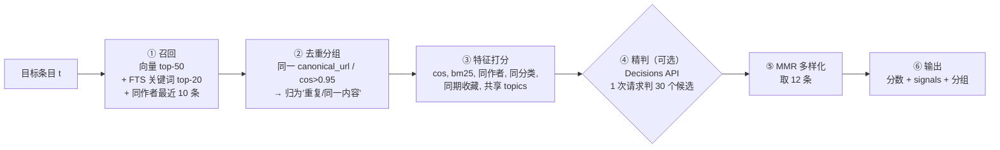

# 相关度与分类：基于 embedding 的具体方案（含 Google Decisions API 的位置）

> 2026-11-19。承接 [design.md](design.md) §5。
> 已核对的事实：Google Decisions API 文档（aistudio.google.com/docs/decisions-api）。代码均为 TS 示意，**没有实际运行**。标注"待验证"的地方需要用你自己的数据做实验。

---

## 0. 先厘清工具：embedding 与 Decisions API 各自擅长什么

### Google Decisions API 的要点（据官方文档）

- 模型：`gemini-decision-1`，端点 `POST /v1beta/decisions`，SDK 为 `client.decisions.create(...)`（要求 SDK ≥ 3.2）。
- **一次请求 = 一份共享 `input` + 1–1000 个相互独立的 `questions`**，在**一次前向计算**中完成。文档说增加问题数量时延迟几乎不变；共享 input 每次请求只计费一次。
- 问题类型：
  - `noul`：是或否，返回 0.01–0.99 的概率和 confidence
  - `choice`：2–255 个选项，返回每个选项的概率和 confidence
  - `score`：2–255 级，返回期望等级、每级概率和 confidence
- **只按输入 token 计费，输出 token 恒为 0**；返回的是**校准过的概率**，可以直接用作阈值。
- 限制：
  - 上下文 262k token
  - 只支持 v1beta，只有这一个模型
  - **不支持 Batch API**，不支持 context caching
  - 文档没有提供"一次请求处理多个独立条目"的模式
  - 价格和限流见单独页面，我没有看到具体数值
- 文档没有提到 embedding 或相似度。

### 两者的分工

| | Embedding | Decisions API |
|---|---|---|
| 本质 | 把每条收藏映射成一个向量，一次计算，可以反复比较 | 针对一份输入回答多个"有类型的问题" |
| 规模特性 | N 条收藏只需 N 次 embed；之后任意两两比较都几乎零成本 | 每个问题都要真正"读懂"内容；适合**少量候选的精判** |
| 擅长 | **召回**：从几千条里快速找出可能相关的 50 条；也可做质心分类 | **精排和判定**：这 50 条里哪些"真的有用地相关"；对拿不准的条目做分类 |
| 输出 | 余弦相似度（不同模型的数值尺度不同，阈值不可移植） | 校准概率（0.8 就意味着大约 80% 正确） |

**结论：采用"embedding 召回 + Decisions API 精判"的两段式。**

之前担心的 N² 成本可以这样化解：
- 全库的两两相似度由 embedding 承担，成本是 O(N) 次 embed 加上可以忽略的向量运算。
- Decisions API 只在用户右键时，对 **1 个目标 × 约 30 个候选**做判定。而且利用"共享 input + 多问题"，**这只需要 1 次请求**。
- 所以每次右键的成本是 O(k)，与收藏总量无关。

---

## 1. 地基：每条收藏的"表征文本"（对效果影响最大的一步）

Embedding 的质量上限由"喂进去的文本"决定，而不是由模型决定。推文没有标题，图片帖几乎没有文字，**这些都要先补全内容**。（默认的 gemini-embedding-2 可以直接 embed 图片，见 [embedding-local-vs-cloud.md](embedding-local-vs-cloud.md)。）

### 1.1 内容补全（enrich），每条收藏只做一次

```
X 推文      : 正文（含长文和线程）+ 引用推文的正文 + 链接卡片（title/description，或抓取落地页的摘要）
              + 图片：用视觉模型生成一句话描述（已允许使用云端模型）
网页文章    : title + og:description + readability 提取的正文前 1–2k 字
用户备注    : 用户手写的 note（信号最强，必须包含进来）
```

然后可以用一个**便宜的 LLM 做一次规范化**，输出一份结构化"卡片"。这份卡片会同时服务于 embedding、分类和 agent 的 `search` 与 `read_item`：

```json
{ "summary": "两三句话：讲了什么、为什么值得收藏",
  "topics": ["Rust", "异步运行时", "tokio"],
  "kind": "tutorial | opinion | tool | news | inspiration | reference | ...",
  "lang": "zh" }
```

### 1.2 拼接表征文本

```ts
function embedText(it: Item, card: Card): string {
  return [
    it.title && `标题: ${it.title}`,
    `摘要: ${card.summary}`,
    card.topics.length && `主题: ${card.topics.join(", ")}`,
    it.userNote && `备注: ${it.userNote}`,
  ].filter(Boolean).join("\n").slice(0, 2000);
}
// 作者、来源、日期不放进文本，而是作为单独的特征（见 §3）。
// 否则"同一个作者"会主导语义相似度，结果就是推荐的全是同一个人的推文。
```

保存 `embed_text` 和 `text_hash = sha1(embed_text)`。只有 hash 变化时才重新 embed，例如用户改了备注，或重新补全了内容。

---

## 2. Embedding 的选择、存储与计算

### 2.1 模型

> 本地与云端的详细对比见 [embedding-local-vs-cloud.md](embedding-local-vs-cloud.md)。结论：默认用 **`gemini-embedding-2`@768**（多模态，和 Decisions API 共用一个 key），本地模型作为可插拔的选项。注意：gemini-embedding-2 **没有 task_type**，改用提示前缀，下文提到 task type 的地方都以那篇文档为准。

- 云端已允许，默认用**和 Decisions API 同一个 Google key 的 Gemini embedding 模型**：一个 key 覆盖两项能力，onboarding 更简单。也可以选 OpenAI 等其他提供方，或本地多语言模型（离线方案）。
- 必须是**多语言模型**：中英混合的收藏要在同一个向量空间里，"异步编程"和 "async runtime" 才能匹配上。
- 如果所选模型支持 **task type**（文档用 / 查询用 / 分类用 / 聚类用）和**可变维度**，就用：
  - 收藏用"文档"类型；`search` 的查询用"查询"类型；分类质心的描述文本用"分类"或"文档"类型。
  - 维度取 768 左右就够用。
  - 具体参数名以 AI Studio 当前文档为准（**待验证**）。
- **向量和模型绑定存储**：`embeddings(item_id, model, dim, vec, text_hash)`。切换模型时，写入新模型的行，后台全量重算，完成后**原子切换** `active_model`，再删除旧行。

### 2.2 计算：暴力搜索就够了

1 万条 × 768 维 × float32 ≈ 30 MB。查询 top-k 只需约 750 万次乘加，用 JS 的 `Float32Array` 大约几毫秒。

```ts
class VectorIndex {
  ids: string[] = []; mat!: Float32Array; dim = 768;      // 行向量预先 L2 归一化 → 点积即余弦
  load(rows: {id: string; vec: Float32Array}[]) { /* 拼成一个连续的 Float32Array */ }
  topK(q: Float32Array, k: number, exclude?: Set<string>) {
    const scores = new Float32Array(this.ids.length);
    for (let i = 0; i < this.ids.length; i++) {
      let s = 0; const o = i * this.dim;
      for (let d = 0; d < this.dim; d++) s += this.mat[o + d] * q[d];
      scores[i] = s;
    }
    return argTopK(scores, k, exclude);                    // 部分排序
  }
  upsert(id: string, vec: Float32Array) { /* 增量：新条目追加，修改过的条目原地覆盖 */ }
}
```

- 持久化仍然用 SQLite 的 BLOB；MCP 启动时加载到内存。
- 到 10 万条以上时，再换成 `sqlite-vec` 或 HNSW 等近似最近邻索引。

---

## 3. 「相关收藏」流水线



### 3.1 召回与打分

```ts
async function related(id: string, k = 12): Promise<RelatedResult> {
  const t = await getItem(id), tv = index.vec(id);
  // ① 召回：语义 + 词面 + 作者，三路合并
  const cands = union(
    index.topK(tv, 50, new Set([id])),
    fts.search(t.card.topics.join(" OR "), 20),          // 补充语义检索漏掉的专有名词（例如库名、人名）
    db.recentByAuthor(t.author, 10),
  );
  // ② 重复检测：单独分组，不占"相关"的名额
  const [dups, rest] = partition(cands, c => c.canonicalUrl === t.canonicalUrl || cos(tv, c.vec) > 0.95);
  // ③ 特征融合（权重先手调，之后用标注数据拟合，见 §5）
  for (const c of rest) {
    c.f = { cos: cos(tv, c.vec), bm25: c.bm25Norm ?? 0, sameAuthor: +(c.author === t.author),
            sameCat: +(c.category === t.category), topicJaccard: jaccard(c.card.topics, t.card.topics),
            nearInTime: Math.exp(-Math.abs(days(c.firstSeenAt, t.firstSeenAt)) / 30) };
    c.score = 0.6*c.f.cos + 0.1*c.f.bm25 + 0.1*c.f.topicJaccard + 0.08*c.f.sameAuthor
            + 0.07*c.f.sameCat + 0.05*c.f.nearInTime;
  }
  let ranked = rest.sort(byScore).slice(0, 30);
  // ④ 精判（设置中可开关；结果会缓存）
  if (settings.rerank === "decisions") ranked = await decisionsRerank(t, ranked);
  // ⑤ 多样化：避免返回 5 条讲同一件事的推文
  const picked = mmr(ranked, c => c.vec, 0.7, k);
  // ⑥ signals 让 UI 能显示"为什么出现在这里"
  return { items: picked.map(c => ({ id: c.id, score: c.score, signals: signalsOf(c) })), duplicates: dups };
}
```

`signalsOf` 输出的标签例如：`语义相近`、`共同主题: Rust, 异步`、`同作者`、`同一时期收藏`。Grid 的"关联视图"可以按 signals 分组展示，例如"同主题 / 同作者 / 那段时间你还收藏了"。最后一组恰好服务于"一段时间后会忘记"这个场景：它能**还原当时的上下文**。

### 3.2 Decisions API 精判：1 个目标 × 30 个候选 = 1 次请求

```ts
async function decisionsRerank(t: Item, cands: Cand[]): Promise<Cand[]> {
  const cached = pairCache.getMany(t.id, cands.map(c => c.id));      // (目标, 候选, 模型版本) → 结果
  const todo = cands.filter(c => !cached.has(c.id));
  if (todo.length) {
    const questions = Object.fromEntries(todo.map(c => [`c_${shortId(c.id)}`, {
      type: "score",
      instructions:
        `候选收藏:\n${c.embedText}\n\n` +
        `这条候选与输入中的收藏有多相关？"相关"指同一主题、概念或问题，` +
        `或者能帮助理解它（背景、延伸、反例、实践）。只是用词相同不算。`,
      criteria: /* 4 级：0 无关 / 1 弱相关 / 2 相关 / 3 强相关，各附一句判定标准（格式以文档为准，待验证） */ RELATED_LEVELS,
    }]));
    const res = await ai.decisions.create({ model: "gemini-decision-1",
      input: `输入收藏:\n${t.embedText}`, questions });
    for (const c of todo) pairCache.set(t.id, c.id, res.answers[`c_${shortId(c.id)}`]);
  }
  return cands
    .map(c => { const a = pairCache.get(t.id, c.id)!; return { ...c, rel: a.score / 3, relConf: a.confidence }; })
    .filter(c => c.rel >= 0.34)                              // 期望等级 < 1（弱相关）的直接隐藏
    .map(c => ({ ...c, score: 0.5 * c.score + 0.5 * c.rel }))
    .sort(byScore);
}
```

| 要点 | 说明 |
|---|---|
| 请求数 | 每次右键 **1 次**，与收藏总量无关 |
| Token | 目标约 200 + 30 个候选 × 约 200 ≈ 6k 输入 token，没有输出 token |
| 为什么用 `score` 而不是 `noul` | 四个等级能**排序**，而不只是过滤；期望等级可以直接融合进分数 |
| 为什么需要它 | Embedding 的典型误判是"表面主题相同但没有用"（例如两条都提到 AI 的无关新闻），而 Decisions API 能判断"真的相关"；返回的校准概率也让阈值有意义 |
| 缓存 | 结果按条目对缓存（`pair_cache` 表），同一对条目只判一次；切换模型版本时失效 |
| 降级 | 失败、限流或关闭时，直接使用 ③ 的分数 |

**"为什么相关"的文字解释**不由 Decisions API 提供（它不输出文本）。UI 上先显示 signals；用户点击"在聊天中探索"时，再由 agent 的 LLM 生成串联性的解读。

---

## 4. 分类

### 4.1 分类体系：从数据中"长"出来，而不是全部预设

首次导入后，用数据提议分类体系，用户确认，而不是强行套用"知识 / 艺术 / …"：

```
① 对所有向量做聚类（k-means，k 取 6–12，用 silhouette 选择；或者 HDBSCAN）
② 每个簇取离质心最近的 8 条，交给 LLM 命名并写一句描述 →「技术与编程」「设计灵感」「投资理财」…
③ 呈现给用户：合并、改名、删除、新增 → 得到最终分类体系（每个类有 name、description，以及种子条目 = 簇中心附近的样本）
④ 内置一份常见分类作为备选（知识 / 技术 / 设计 / 艺术 / 商业 / 生活 / 娱乐 / 其他）
```

每条收藏只有一个**主分类**，用于 Grid 筛选。更细的**主题**（簇内再聚类，或使用 `card.topics`）作为第二层浏览维度。

### 4.2 三级分类器（入库时运行）

```ts
async function classify(it: Item): Promise<Assignment> {
  if (it.userCategory) return { cat: it.userCategory, source: "user" };   // 用户的选择永远优先

  // ① kNN 投票：用户已确认的样本足够多时最准，并且会随使用自动改进
  const labeled = index.topK(it.vec, 15, undefined, onlyLabeled);
  if (labeled.length >= 10) {
    const p = vote(labeled, w => Math.exp(w.cos / 0.05));                 // 按相似度加权的 softmax 投票
    if (p.top >= TAU.knn) return { cat: p.cat, p: p.top, source: "knn" };
  }
  // ② 质心法：零样本也能工作
  const p = softmax(categories.map(c => cos(it.vec, c.centroid) / 0.03)); // 温度系数需要标定
  if (p.top >= TAU.high && p.top - p.second >= TAU.margin)
    return { cat: p.cat, p: p.top, source: "centroid" };

  // ③ 拿不准 → Decisions API choice（校准概率）
  const a = await decide(it);   // 见 4.3
  if (a.confidence >= TAU.decision) return { cat: a.choice, p: a.confidence, source: "decision" };

  return { cat: p.cat, p: p.top, source: "pending" };                     // 放进「待确认」托盘
}

// 质心 = 归一化的加权平均：用户确认的样本权重最高，种子样本其次，描述文本最低
centroid(c) = normalize( 3·mean(embed(用户确认的条目)) + 1·mean(embed(种子条目)) + 1·embed(c.name + ": " + c.description) )
```

### 4.3 Decisions API 分类：一次请求顺带问多个问题

因为"增加问题几乎不增加延迟"、只对输入计费，所以**同一次请求可以顺带完成其他标注**：

```ts
const res = await ai.decisions.create({
  model: "gemini-decision-1",
  input: it.embedText,
  questions: {
    category:  { type: "choice", instructions: "这条收藏最适合归入哪一类？",
                 criteria: /* 选项 = 分类 key，每个选项附 description（格式待验证） */ CATEGORY_OPTIONS },
    kind:      { type: "choice", instructions: "内容形态", criteria: KIND_OPTIONS },   // 教程/观点/工具/新闻/灵感/参考
    evergreen: { type: "noul",   instructions: "这条内容过一年后仍然有参考价值吗？" },  // 可用于"值得重温"排序
  },
});
```

**批量技巧（待验证）**：文档没有"多条目批处理"模式，也不支持 Batch API。有一个可以尝试的做法：把 **20–50 条收藏编号后放进同一个 `input`**，每条对应一个 `choice` 问题（"第 7 条属于哪一类？"）。这样首次导入时的请求数可以降一到两个数量级。但条目之间可能互相干扰，**必须先在 §5 的标注集上和逐条请求的结果对比**，准确率不下降才能采用。

### 4.4 冷启动流程与主动学习

```
导入 3,000 条
 → enrich + embed（后台进行，带进度）
 → 聚类并提议分类体系 → 用户确认（1 分钟）
 → 三级分类器全量跑一遍：预计大部分由质心法直接决定，小部分走 Decisions API，少量进入「待确认」
 → 「待确认」托盘：按不确定度排序，每条显示 top-2 候选，一键确认
     每确认一条 → 成为样本 → 质心和 kNN 更新 → 对 source ∈ {centroid, knn} 的条目在后台重新分类
 → 用户手动改分类：同样作为样本（并作为负样本降低原分类的权重）
```

- **主动学习**：优先让用户确认"最不确定"的条目，每次确认带来的信息量最大。
- **分类体系变更**（新增、合并、改名）：重算质心，**只重新分类自动分配的条目**，用户确认过的不动。

---

## 5. 评测与调参（没有这一步，上面的权重和阈值都只是猜测）

| 对象 | 标注方式 | 指标 |
|---|---|---|
| 相关度 | 抽 30 个目标条目，对每个目标的候选标注 0–3 级。可以先让强模型预标注，再由你人工校对 | nDCG@10、Precision@10；分别比较"只用 embedding"、"加特征融合"、"再加 Decisions 精判"三种配置 |
| 分类 | 抽 200 条人工标注 | 准确率、覆盖率（自动决定的比例）、各级阈值下的"错误自动分类率" |
| 批量技巧 | 同一批 200 条，分别用逐条请求和 30 条一批请求 | 准确率差异 |

**用户反馈闭环**：在关联视图里给每条结果加一个"不相关"按钮，记为负样本对：
- 以后不再出现。
- 积累到一定数量后，用来拟合 §3.1 中的权重，例如用逻辑回归对特征重新加权。

**需要标定的参数**：softmax 温度、`TAU.*` 系列阈值、MMR 的 λ、Decisions 精判的过滤阈值。**换 embedding 模型后必须重新标定**，因为余弦相似度的尺度会变化。

---

## 6. 增量更新与触发时机

| 事件 | 动作 |
|---|---|
| 同步到新条目 | enrich → embed → `index.upsert` → classify |
| 用户编辑标题或备注 | 重新生成 embed_text，hash 变化就重新 embed，必要时重新分类（用户确认过的分类保持不变） |
| 用户修改分类 | 记为样本，更新质心，后台重新分类自动分配的条目 |
| 右键「相关收藏」 | 实时计算 + 条目对缓存，不预先存储相关列表 |
| 切换 embedding 模型 | 后台全量重算，原子切换，重新标定阈值。Decisions 的条目对缓存**不必清空**：它按条目对和 Decisions 模型版本索引，与 embedding 无关 |
| 修改分类体系 | 重算质心，重新分类自动分配的条目 |

同一套向量还服务于 agent 的 `search` 工具：查询向量（"查询"类型）和 FTS（trigram）的结果用 **RRF（倒数排名融合）**合并。这顺带解决了少于 3 个字的中文查询在 FTS 中匹配不到的问题。

---

## 7. 成本粗估（价格待你查 pricing 页填入）

以 3,000 条首次导入、之后每天新增约 20 条为例：

| 项 | 量级 |
|---|---|
| enrich（便宜的 LLM 生成卡片，加视觉模型描述图片） | 3,000 次 × 约 1k 输入 token，一次性 |
| embed | 3,000 × 约 300 token，一次性；embedding 很便宜 |
| Decisions 分类 | 只针对质心法拿不准的部分。逐条请求约几百次；如果批量技巧验证通过，降到十几次 |
| Decisions 精判 | 每次右键 1 次请求，约 6k token；有缓存，重复查看不再计费 |
| 日常增量 | 每天 20 条 × 上述流程，可以忽略 |

---

## 8. 落到 MCP 的模块划分

```
collections-mcp/
  enrich/        卡片生成、链接展开、图片描述
  embed/         提供方适配（gemini | openai | local）、模型版本、重建索引任务
  index/         VectorIndex（内存）+ FTS + RRF
  related/       召回 → 特征 → 精判(decisions) → MMR → signals；pair_cache
  classify/      分类体系、质心与 kNN、decisions 兜底、待确认队列、主动学习
  decisions/     Google Decisions API 客户端（限流、重试、缓存）
  eval/          标注集、离线评测脚本
```

`related` 和 `classify` 都要做成**纯函数接口加可替换的后端**。在设置里可以切换：精判使用 off / decisions / llm，分类兜底使用 decisions / llm。这样就可以在评测集上直接对比不同后端的效果。
